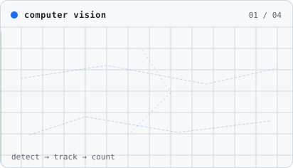

<picture>
  <source media="(prefers-color-scheme: dark)" srcset="assets/hero-dark.svg">
  
</picture>

I got into this through computer vision: cameras pointed at a factory gate, a crane or a highway, and code that has to keep running after everyone has gone home. These days I also spend a lot of my time on evaluation, LLM agents and robot simulation.

  <picture><source media="(prefers-color-scheme: dark)" srcset="assets/vision-dark.svg"></picture>
  <picture><source media="(prefers-color-scheme: dark)" srcset="assets/eval-dark.svg"></picture>
  <picture><source media="(prefers-color-scheme: dark)" srcset="assets/agent-dark.svg"></picture>
  <picture><source media="(prefers-color-scheme: dark)" srcset="assets/sim-dark.svg"></picture>

<picture>
  <source media="(prefers-color-scheme: dark)" srcset="assets/merge-dark.svg">
  
</picture>

### Stack

  <picture>
    <source media="(prefers-color-scheme: dark)" srcset="https://skillicons.dev/icons?i=python%2Cpytorch%2Copencv%2Cfastapi%2Cdocker%2Cgo%2Cpostgres%2Credis%2Cnextjs%2Cthreejs%2Cblender%2Cgcp%2Clinux%2Cgit&perline=14&theme=dark">
    
  </picture>

Things that don't have a logo

 

| Track | Tools |
|---|---|
| Computer vision | YOLO · RF-DETR · pose models · tracking · PaddleOCR · ONNX / CoreML |
| Data & evaluation | benchmark design · test-set leak checks |
| LLM & agents | Google ADK · Gemini · Whisper · Qwen3 · Cloud Run |
| Robotics & simulation | Isaac Sim · synthetic data |

### Some results

- 🤖 7 computer vision systems shipped to production
- 🥇 AMD Developer Hackathon ACT II, team 1st place and Best Solution
- 🥈 SuperAI Season 5, Silver Medal
- 🎓 B.Eng. Computer Engineering, KMITL, Second Class Honours

<picture>
  <source media="(prefers-color-scheme: dark)" srcset="https://raw.githubusercontent.com/Jems-Chawin/Jems-Chawin/output/snake-dark.svg">
  
</picture>

  <a href="https://www.linkedin.com/in/chawin-sriviset/">LinkedIn</a> · <a href="mailto:chawinsriviset@gmail.com">chawinsriviset@gmail.com</a>

